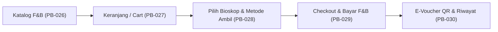
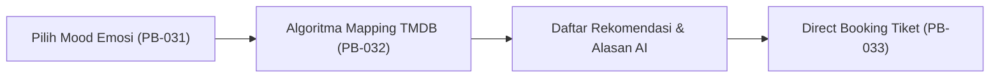

# 📋 CATATAN TUGAS & ROADMAP PENGEMBANGAN TIM CINEMATE

Dokumen ini berisi panduan pembagian tugas, spesifikasi *user stories*, kriteria penerimaan (*acceptance criteria*), dan referensi teknis untuk anggota tim pengembang **Cinemate** pada **Sprint 3** dan **Sprint 4**.

---

## 📊 1. Status Milestone Terkini

| Sprint | Epic / Modul | Cakupan Task | Status | Verifikasi & Kualitas |
| :--- | :--- | :--- | :---: | :--- |
| **Sprint 1** | **Epic Fondasi Teknis (TEK)** | PB-001 s.d. PB-004 | **100% SELESAI** | Dio HTTP, Supabase Schema, Local Storage Hive & Secure |
| **Sprint 1** | **Epic Autentikasi (AUT)** | PB-005 s.d. PB-008 | **100% SELESAI** | Register, Login (Lockout 5x), Session, Logout |
| **Sprint 2** | **Epic Dashboard (DSH)** | PB-011 s.d. PB-015 | **100% SELESAI** | 5 Nav Tabs, TMDB Banner/Now Playing, Hive Cache, Movie Detail, LBS Bioskop Terdekat |
| **Sprint 2** | **Epic Tiket (TKT)** | PB-018 s.d. PB-025 | **100% SELESAI** | Book by Cinema/Movie, Order Summary, Simulasi Payment, QR E-Ticket, Offline Hive, Active/History Filter & Check-in Simulation |

> **Statistik Pengujian Terkini:**
> - Unit & Integration Test: **28 / 28 Passed (100%)**
> - Static Analysis: **0 Issues (`dart analyze lib test`)**
> - Branch Terakhir: `feat/pb-024-025-offline-tickets-history`

---

## 🎯 2. Roadmap Sprint 3: F&B & Mood AI Recommendations

### 🍿 Epic 3.1: Pesan Makanan & Minuman / F&B (FNB)
Mengintegrasikan katalog makanan & minuman bioskop, manajemen keranjang (*cart*), pilihan metode *pick-up* / *delivery to seat*, simulasi pembayaran, serta penerbitan *E-Voucher QR Code F&B*.



#### Backlog Items Epic F&B:
1. **PB-026: Katalog F&B Supabase & Hive Offline Cache**
   - **Tabel Basis Data:** `public.fnb_items` (Kolom: `id`, `name`, `description`, `price`, `category`, `image_url`, `is_available`).
   - **Seed Data:** Popcorn Regular/Large, Nachos, Coca-Cola Regular/Large, Air Mineral, Combo 1, Combo 2, Hot Dog, Pretzel.
   - **Model:** Buat [`FnbItemModel`](file:///C:/Users/Pongo/Documents/Praktikkum_Pemrogramman_Mobile/project/Cinemate/lib/models/fnb_item_model.dart).
   - **Service:** Buat [`FnbService`](file:///C:/Users/Pongo/Documents/Praktikkum_Pemrogramman_Mobile/project/Cinemate/lib/services/fnb_service.dart) dengan cache Hive box `fnb_cache` (TTL 12 jam) dan fallback offline.
   - **UI:** Perbarui [`FnbTab`](file:///C:/Users/Pongo/Documents/Praktikkum_Pemrogramman_Mobile/project/Cinemate/lib/views/dashboard/tabs/fnb_tab.dart) dengan chip filter kategori (*Semua*, *Snack*, *Drink*, *Combo*, *Food*) serta skeleton loading.

2. **PB-027: State Manajemen Keranjang F&B (Cart Controller)**
   - **Controller:** Buat [`FnbController`](file:///C:/Users/Pongo/Documents/Praktikkum_Pemrogramman_Mobile/project/Cinemate/lib/controllers/fnb_controller.dart).
   - **Fitur Cart:**
     - State `cartItems = <FnbItemModel, int>{}.obs`.
     - Fungsi `addItem()`, `removeItem()`, `clearCart()`.
     - Getter `totalQuantity`, `subtotalPrice`, `taxAmount`, `grandTotalPrice`.
   - **UI:** Tampilkan floating bottom summary bar di [`FnbTab`](file:///C:/Users/Pongo/Documents/Praktikkum_Pemrogramman_Mobile/project/Cinemate/lib/views/dashboard/tabs/fnb_tab.dart) saat keranjang berisi minimal 1 item.

3. **PB-028: Lokasi Bioskop & Pilihan Metode Pengambilan**
   - Pengguna memilih bioskop tempat pesanan F&B akan diambil (memanfaatkan data dari [`CinemaController`](file:///C:/Users/Pongo/Documents/Praktikkum_Pemrogramman_Mobile/project/Cinemate/lib/controllers/cinema_controller.dart)).
   - **Pilihan Metode:**
     - *Ambil di Counter (Self Pick-up):* Mengantre di counter concession dengan kode pengambilan.
     - *Antar ke Kursi Studio (Delivery to Seat):* Mengisi / otomatis memilih dari tiket aktif pengguna (nomor studio dan kursi).

4. **PB-029: Simulasi Pembayaran F&B & E-Voucher QR Code**
   - Transaksi disimpan ke tabel Supabase `public.fnb_orders` dan `public.fnb_order_items`.
   - Generate kode unik pesanan F&B (misal: `FNB-78219`).
   - Tampilkan E-Voucher dengan QR Code dinamis menggunakan package `qr_flutter`.
   - Simpan salinan E-Voucher ke Hive box `fnb_orders_cache` agar bisa dibuka secara offline saat di bioskop.

5. **PB-030: Tab Riwayat & Pelacakan Pesanan F&B**
   - Pada [`FnbTab`](file:///C:/Users/Pongo/Documents/Praktikkum_Pemrogramman_Mobile/project/Cinemate/lib/views/dashboard/tabs/fnb_tab.dart), sediakan sub-tab / tombol "Pesanan Saya".
   - Status pesanan: `processing` (disiapkan), `ready` (siap diambil di counter), `completed` (selesai diambil).
   - Sediakan tombol simulasi untuk petugas: ubah status dari `processing` -> `ready` -> `completed`.

---

### 🎭 Epic 3.2: Rekomendasi Film Berbasis Mood AI (MOD)
Mewujudkan slogan utama aplikasi Cinemate: *"Temukan film sesuai mood-mu"*. Pengguna memilih suasana hati saat ini, dan sistem merekomendasikan film TMDB yang relevan, lengkap dengan direct booking.



#### Backlog Items Epic Mood AI:
1. **PB-031: Layar Pemilih Mood Interaktif**
   - Banner/Widget di [`HomeTab`](file:///C:/Users/Pongo/Documents/Praktikkum_Pemrogramman_Mobile/project/Cinemate/lib/views/dashboard/tabs/home_tab.dart): *"Bingung mau nonton apa? Coba Mood AI ✨"*.
   - Layar interaktif `MoodPickerView` menampilkan 6 pilihan emosi dengan visual estetik:
     - 😃 **Happy (Senang/Ceria):** Ingin tontonan yang menghibur dan bikin tertawa.
     - 😢 **Sad (Sedih/Haru):** Ingin tontonan menyentuh hati dan katarsis emosi.
     - ❤️ **Romantic (Romantis):** Ingin film tentang cinta, rom-com, dan kehangatan.
     - ⚡ **Thrilled (Tegang/Adrenalin):** Ingin aksi intens, misteri mendebarkan, atau horor.
     - 🧘 **Chill (Rileks/Santai):** Ingin petualangan santai, visual memukau, atau sci-fi ringan.
     - 🥱 **Bored (Bosan/Butuh Kejutan):** Ingin film yang tidak tertebak dengan plot twist cerdas.

2. **PB-032: Mood-to-Genre Engine & Filter TMDB API**
   - Buat `MoodRecommendationService` di `lib/services/mood_service.dart`.
   - Pemetaan Genre ID TMDB:
     - `Happy` $\rightarrow$ 35 (Comedy), 16 (Animation), 10751 (Family).
     - `Sad` $\rightarrow$ 18 (Drama).
     - `Romantic` $\rightarrow$ 10749 (Romance), 35 (Comedy).
     - `Thrilled` $\rightarrow$ 28 (Action), 27 (Horror), 53 (Thriller).
     - `Chill` $\rightarrow$ 12 (Adventure), 878 (Science Fiction), 14 (Fantasy).
     - `Bored` $\rightarrow$ 9648 (Mystery), 80 (Crime).
   - Panggil TMDB endpoint `/discover/movie` dengan query parameters:
     - `with_genres`: ID genre yang sesuai.
     - `sort_by`: `popularity.desc`.
     - `vote_average.gte`: `7.0`.

3. **PB-033: Hasil Rekomendasi & Aksi Direct Booking**
   - Tampilkan kartu rekomendasi film dengan:
     - Badge persentase kecocokan mood (misal: *98% Cocok untuk Mood Bahagia*).
     - Alasan rekomendasi dari AI Cinemate.
     - Tombol sticky **"Pesan Tiket Film Ini"** yang langsung membuka flow pemesanan film **PB-019** ([`BookByMovieView`](file:///C:/Users/Pongo/Documents/Praktikkum_Pemrogramman_Mobile/project/Cinemate/lib/views/booking/book_by_movie_view.dart)).

---

## ⚙️ 3. Roadmap Sprint 4: Profil Pengguna, Preferensi & Pengingat Notifikasi

### 👤 Epic Profil & Preferensi (PRF & NOT)
1. **PB-048: Konversi Mata Uang Dinamis (Currency Preference)**
   - Opsi mata uang di [`ProfileTab`](file:///C:/Users/Pongo/Documents/Praktikkum_Pemrogramman_Mobile/project/Cinemate/lib/views/dashboard/tabs/profile_tab.dart):
     - **IDR (Rp)** — Default (1.0).
     - **USD ($)** — Kurs konversi misal Rp 15.500 / USD.
     - **SGD (S$)** — Kurs konversi misal Rp 11.500 / SGD.
     - **EUR (€)** — Kurs konversi misal Rp 16.800 / EUR.
   - Simpan pilihan di `GetStorage` via `StorageService`.
   - Buat helper `CurrencyFormatter` agar semua harga tiket dan F&B terkonversi secara reaktif di seluruh aplikasi.

2. **PB-049: Penyesuaian Zona Waktu Dinamis (Timezone Preference)**
   - Opsi zona waktu di [`ProfileTab`](file:///C:/Users/Pongo/Documents/Praktikkum_Pemrogramman_Mobile/project/Cinemate/lib/views/dashboard/tabs/profile_tab.dart): **WIB (UTC+7)**, **WITA (UTC+8)**, **WIT (UTC+9)**, **GMT/UTC**.
   - Jadwal tayang bioskop otomatis disesuaikan dengan zona waktu yang dipilih pengguna beserta penanda formatnya.

3. **PB-050: Edit Profil Pengguna & Ganti Password**
   - Layar `EditProfileView`: Memungkinkan user mengubah `full_name` dan `phone`, lalu memperbarui tabel `public.users` di Supabase.
   - Layar `ChangePasswordView`: Verifikasi password lama, hashing password baru (*salt + SHA-256*), lalu update kolom `password_hash`.

4. **PB-058: Integrasi Local Push Notification Pengingat Tiket**
   - Dependensi: `flutter_local_notifications` (referensi praktikum modul 8).
   - Penanganan permission Android 13+ (`POST_NOTIFICATIONS`).
   - Trigger otomatis saat tiket berstatus `paid`:
     - **H-1 Jam sebelum tayang:** Notifikasi *"Tiket Anda untuk [Judul Film] dimulai 1 jam lagi!"*.
     - **H-30 Menit sebelum tayang:** Notifikasi *"Studio segera dibuka! Siapkan E-Ticket offline Anda"*.

---

## 👥 4. Rekomendasi Pembagian Tugas Anggota Tim

| Anggota Tim | Fokus Tanggung Jawab | File & Modul yang Dikerjakan |
| :--- | :--- | :--- |
| **Developer A (Frontend F&B & Cart)** | UI Katalog F&B, filter chip kategori, state keranjang belanja, floating summary bar. | `fnb_item_model.dart`, `fnb_controller.dart`, `fnb_tab.dart`, `fnb_cart_bottom_sheet.dart` |
| **Developer B (Backend F&B & Supabase)** | Service F&B Supabase, caching Hive, order checkout, E-Voucher QR generation, riwayat pesanan F&B. | `fnb_service.dart`, `fnb_order_model.dart`, `supabase_schema.sql`, `fnb_order_detail_view.dart` |
| **Developer C (AI Mood Recommendations)** | Layar pemilih emosi, algoritma mapping TMDB API, view hasil rekomendasi film, direct booking action. | `mood_service.dart`, `mood_controller.dart`, `mood_picker_view.dart`, `mood_result_view.dart` |
| **Developer D (Profile, Currencies & Notifikasi)** | Currency formatter (IDR/USD/SGD/EUR), timezone converter (WIB/WITA/WIT), edit profile, `flutter_local_notifications`. | `currency_helper.dart`, `profile_tab.dart`, `edit_profile_view.dart`, `notification_service.dart` |

---

## 🛠️ 5. Standar Koding, Arsitektur, & Panduan Branching

### 📌 Standar Arsitektur (GetX OOP Clean Pattern)
1. **Model:** Wajib menyediakan `fromJson`, `toJson`, dan `copyWith`.
2. **Service:** Bertanggung jawab atas I/O (Supabase, Dio HTTP, Hive). Selalu gunakan `try-catch` dengan penanganan offline yang anggun (*graceful fallback*).
3. **Controller:** Berisi state (`Rx`), logika bisnis, validasi form, dan kalkulasi matematis. UI tidak boleh berisi query database langsung!
4. **View:** Hanya merender antarmuka pengguna, mendengarkan controller via `Obx()`, dan memicu event.
5. **Theme & Colors:** Wajib konsisten dengan [AppColors](file:///C:/Users/Pongo/Documents/Praktikkum_Pemrogramman_Mobile/project/Cinemate/lib/utils/app_colors.dart) (*Dark Cinema Palette*).

### 🌿 Aturan Branching Git
```bash
# Untuk Sprint 3 Epic F&B:
git checkout -b feat/pb-026-030-fnb-ordering

# Untuk Sprint 3 Epic Mood AI:
git checkout -b feat/pb-031-033-mood-ai-recommendations

# Untuk Sprint 4 Epic Profil & Notifikasi:
git checkout -b feat/pb-048-058-profile-preferences-notifications
```

### ✅ Checklist Kualitas Sebelum Pull Request (PR)
Sebelum melakukan push atau meminta merge, setiap anggota tim **wajib** menjalankan:
```bash
# 1. Pastikan tidak ada syntax error atau code warning:
dart analyze lib test

# 2. Pastikan seluruh unit test lolos tanpa kegagalan:
flutter test

# 3. Format kode rapi:
dart format lib test
```

---

*Dokumen ini dibuat otomatis sebagai panduan kerja tim Cinemate. Jika ada pertanyaan arsitektur atau kebutuhan integrasi, koordinasikan dengan lead developer atau review code di pull request.*
